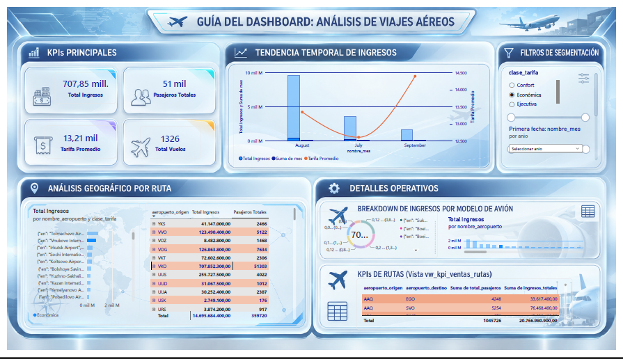

# ✈️ Análisis de transacciones aéreas

Proyecto de ingeniería de datos y Business Intelligence para analizar transacciones del sector aeronáutico. El flujo cubre la ingesta y transformación de datos con Databricks, su organización en capas Medallion y la construcción de un modelo dimensional para su exploración en Power BI.

## 📸 Vista previa del dashboard

El archivo editable de Power BI está disponible en [`pbix/Proyecto_DataEngine_BI_Vuelos.pbix`](pbix/Proyecto_DataEngine_BI_Vuelos.pbix).

## 🏗️ Arquitectura de la solución

### Databricks y arquitectura Medallion

Los notebooks de [`databricks/`](databricks/) documentan el flujo por capas:

1. **Bronze:** ingesta de los datos de origen.
2. **Silver:** limpieza y transformación; incluye dimensiones de aviones, aeropuertos, asientos y pasajeros/tiquetes.
3. **Gold:** creación de la tabla de hechos `gold_fact_ventas_vuelos`, la dimensión `dim_tiempo` y la vista `vw_kpi_ventas_rutas` para el análisis.

### Modelo y visualización

El modelo analítico organiza las ventas de vuelos en una tabla de hechos relacionada con dimensiones. El dashboard de Power BI permite explorar indicadores y vistas del negocio. El archivo `.pbix` contiene el modelo y la visualización editables en Power BI Desktop.

## 📂 Estructura del repositorio

- [`databricks/`](databricks/): notebooks de ingesta Bronze, transformación Silver y modelo Gold.
- [`pbix/`](pbix/): proyecto editable de Power BI Desktop.
- [`docs/`](docs/): imagen de vista previa del dashboard.

## 🛠️ Tecnologías

- Databricks
- PySpark y Spark SQL
- Arquitectura Medallion (Bronze, Silver y Gold)
- Modelado dimensional
- Power BI Desktop
